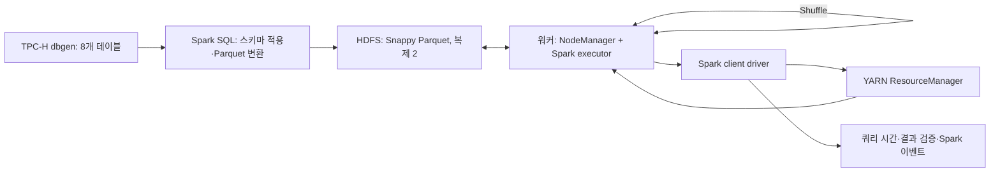

# TPC-H 실험 아키텍처

## 소프트웨어 및 데이터 배치

Spark 3.5.7, Hadoop HDFS/YARN 3.3.6, Java 11. HDFS 블록 128MiB, 복제 계수 2. 워커당 YARN 8 vcore와 64GiB를 할당했다. 워커마다 7코어 실행기 한 개를 배치했다. 실행기 힙은 48GiB, 오버헤드는 6GiB이며 클라이언트 드라이버는 4GiB다. AQE는 끄고 셔플 파티션 수는 96으로 유지했다.

연도 파티션은 orders의 주문 연도와 lineitem의 선적 연도에 적용했다. 해당 날짜 조건이 있는 쿼리에는 동등한 연도 조건을 추가했다. 큰 테이블은 조인 키를 기준으로 32개 버킷으로 구성했고 nation·region을 브로드캐스트했다. 전체 최적화 실행에서는 CBO와 조인 순서 최적화를 켰다.

## 토폴로지

| 실험 | 제어 노드 | 워커 | 데이터 경로 |
|---|---|---|---|
| SF1·10·30·100 및 ablation | 54번 | 214·54·228번 | 전용 사설 유선 LAN |
| SF100 노드 확장 | 43번 | 214·54 → +228 → +43 → +149 → +56 | 학교 유선망의 서버 간 직접 TCP |

확장 실험에서는 Spark 실행기와 HDFS DataNode를 함께 늘렸다. 43번은 모든 조건에서 NameNode·ResourceManager·드라이버를 유지했고 4대 조건부터 워커 역할을 추가했다. 149번은 다른 서브넷에서 라우팅했다. 6대 전 조합의 양방향 접속을 사전에 확인했다. 이전 WireGuard 경유 실험은 최종 확장 결과에서 제외했다.

| 노드 | CPU | 물리 코어 / 스레드 | 인식 RAM | 실험 저장소 |
|---|---|---:|---:|---|
| 214 | Xeon Silver 4210R | 20 / 40 | 252GiB | 1.8TiB SSD |
| 54 | Xeon Gold 6226R | 32 / 64 | 252GiB | 1.8TiB NVMe |
| 228 | Xeon Silver 4210R | 20 / 40 | 252GiB | 3.5TiB SSD |
| 43 | Xeon Gold 6526Y | 32 / 64 | 504GiB | 3.5TiB NVMe |
| 149 | Xeon Gold 6530 | 64 / 128 | 630GiB | 3.5TiB NVMe |
| 56 | Xeon Gold 6226R | 32 / 64 | 252GiB | 1.8TiB NVMe |

## 측정 및 검증

22개 쿼리로 구성된 워밍업 1회와 본 측정 3회를 수행했다. 회차 결과는 22개 SQL 실행시간의 합이다. Ablation은 한 번에 하나의 요소만 끄고, baseline은 네 요소를 모두 껐다. 확장 2~5대에서 본 측정 결과는 기준 결과와 일치했다. 6대는 디스크 여유 공간 부족으로 워밍업에서 중단됐다. [확장 결과 CSV](../results/sf100-node-scaling.csv)
